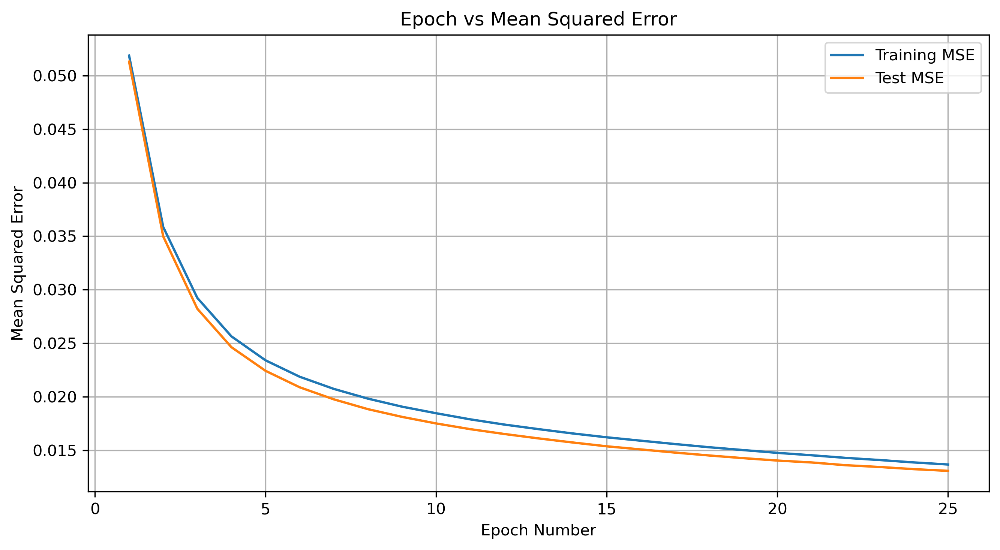
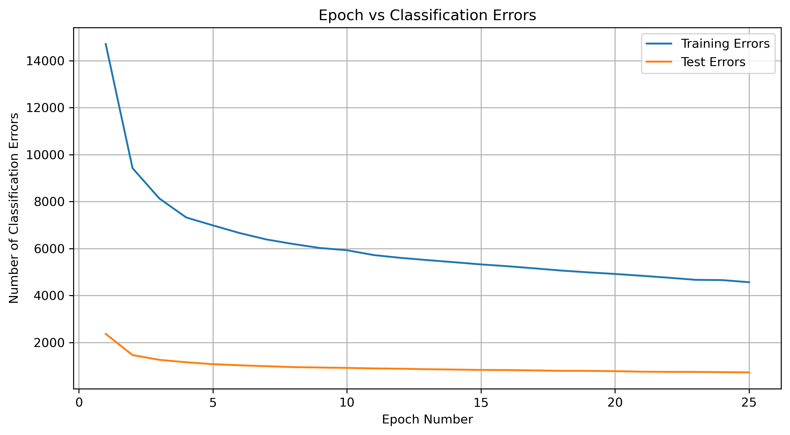

# MNIST Handwritten Digit Classification Using Neural Networks

## Project Overview

This project implements a feedforward Artificial Neural Network (ANN) trained using the backpropagation algorithm to classify handwritten digits from the MNIST dataset.

The neural network is implemented using Python and NumPy, with the forward propagation, error calculation, gradient computation, and weight updates performed manually rather than relying on a high-level deep learning framework.

The objective is to understand how neural networks learn, evaluate their classification performance, and investigate how different hyperparameters affect training.

**Best Test Accuracy: 97.50%**

## Dataset

The project uses the MNIST handwritten digit dataset, which contains:

- 60,000 training images
- 10,000 testing images
- 28 × 28 grayscale images
- 10 output classes representing digits 0–9

Each image is flattened into a 784-dimensional input vector. Pixel values are normalized before training, and digit labels are converted into one-hot encoded vectors.

## Neural Network Architecture

The network consists of three layers:

| Layer | Number of Neurons |
|---|---|
| Input Layer | 784 |
| Hidden Layer | 128 |
| Output Layer | 10 |

### Implementation Details

- **Programming Language:** Python
- **Libraries:** NumPy, Matplotlib
- **Weight Initialization:** Xavier initialization
- **Activation Function:** Sigmoid
- **Training Algorithm:** Backpropagation
- **Optimization:** Mini-batch gradient descent
- **Output Representation:** One-hot encoding

The network computes predictions through forward propagation, calculates prediction errors, and updates its weights using gradients obtained through backpropagation.

## Experiments

Two training configurations were evaluated to study how learning rate, batch size, and training duration affect performance.

| Parameter | Experiment 1 | Experiment 2 |
|---|---|---|
| Hidden Neurons | 128 | 128 |
| Learning Rate | 0.1 | 0.5 |
| Batch Size | 64 | 32 |
| Epochs | 25 | 40 |
| Training Accuracy | 92.39% | 98.69% |
| Testing Accuracy | 92.73% | 97.50% |
| Testing Errors | 727 | 250 |
| Testing MSE | 0.013073 | 0.004416 |

### Best Model Performance

The second configuration achieved the strongest results:

- Training Accuracy: **98.69%**
- Testing Accuracy: **97.50%**
- Training Errors: 783
- Testing Errors: 250
- Training MSE: 0.002820
- Testing MSE: 0.004416

## Key Observations

1. The second configuration achieved higher training and testing accuracy.
2. Increasing the learning rate, reducing the batch size, and training for more epochs together improved performance in this experiment.
3. The difference between training and testing accuracy was relatively small, suggesting that the model generalized reasonably well to unseen handwritten digits.
4. Implementing backpropagation manually provided practical experience with gradient computation and neural network optimization.

Because several hyperparameters were changed simultaneously, the improvement cannot be attributed to any single parameter.

## Project Structure

```text
mnist-digit-classification-neural-network/
├── MNIST_Backpropagation.ipynb
├── README.md
├── requirements.txt
├── .gitignore
└── LICENSE
```

## How to Run

### 1. Clone the Repository

```bash
git clone https://github.com/tatinenijoshika424/mnist-digit-classification-neural-network.git
cd mnist-digit-classification-neural-network
```


### 2. Install Dependencies

```bash
pip install -r requirements.txt
```

### 3. Download the MNIST Dataset

Download the MNIST IDX dataset files and place them inside a folder named `data`:

```text
data/
├── train-images-idx3-ubyte.gz
├── train-labels-idx1-ubyte.gz
├── t10k-images-idx3-ubyte.gz
└── t10k-labels-idx1-ubyte.gz
```

### 4. Run the Notebook

Launch Jupyter Notebook:

## Training Visualizations

The following graphs show how the neural network's accuracy and mean squared error changed during training for two different hyperparameter configurations.

### Experiment 1 — Test Accuracy: 92.73%

**Accuracy vs. Epochs**


**Mean Squared Error vs. Epochs**



### Experiment 2 — Test Accuracy: 97.50%

**Accuracy vs. Epochs**



**Mean Squared Error vs. Epochs**


### Comparison

Experiment 2 achieved higher training and testing accuracy and lower mean squared error than Experiment 1. The experiments used different learning rates, batch sizes, and training durations.


